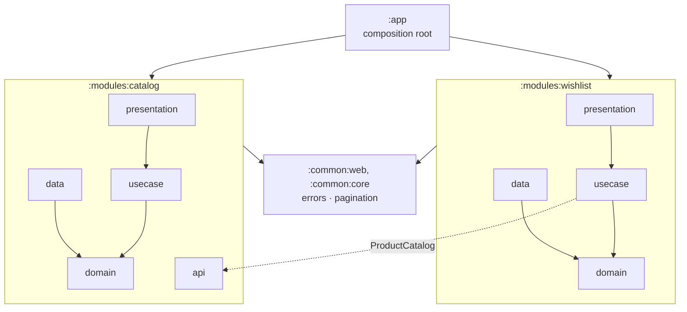

# Shopping API

A Kotlin + Spring Boot backend for a mobile shopping app: browse, search and filter products, and keep a personal wishlist.

**Stack:** Kotlin 2.4 · Spring Boot 4.1 (Spring MVC with `suspend` controllers) · Coroutines & Flow · JDK 21 · Gradle 9 · JUnit 6 + kotest · Konsist · Bruno

## Run

```bash
./gradlew :app:bootRun
```

The API starts on http://localhost:8080; set `PORT` to change it. You need JDK 21, which Gradle can download for you.

| | |
|---|---|
| Swagger UI | http://localhost:8080/swagger-ui.html |
| Health | http://localhost:8080/actuator/health |

## Architecture

A **modular monolith**: one deployable, split into Gradle modules. Each feature module follows **Clean Architecture**.



| Layer | Holds | Rule |
|---|---|---|
| `domain` | Entities, repository interfaces, domain errors | Plain Kotlin; depends on nothing |
| `usecase` | One class per use case (`ListProducts`, `AddToWishlist`, …) | Plain Kotlin; depends only on `domain` |
| `data` | Data sources: in-memory repository implementations | Implements `domain` interfaces |
| `presentation` | Controllers and response models | Calls use cases |
| `api` | A module's public interface | The only part another module may use |

- **Dependency injection:** each module wires itself in one `@Configuration` (`CatalogModule`, `WishlistModule`). No Spring code exists inside `domain` or `usecase`.
- **Coroutines and Flow:**
  - Controllers and use cases are `suspend` functions.
  - Repositories return `Flow`.
  - Wishlist edits are atomic `StateFlow` updates.
- **Two product models:**
  - `Product` (id, name, description, imageUrl, price) is used by lists and search.
  - `ProductDetails` adds brand and category, and is used by `GET /products/{id}`.
- **Wishlist per session:**
  - Clients send an `X-Session-Id` header (a UUID generated once per install).
  - A header suits mobile clients better than cookies, and the id maps directly to a user id once auth exists.
  - Wishlists live in memory, so they reset when the app restarts.
- **Errors:** RFC 9457 `application/problem+json` with a stable `code` and an actionable `detail`.
- **Enforced:** these rules are executable. `ArchitectureTest` (Konsist) fails the build if one is broken.

More detail is in [`adr/`](adr/).

## Endpoints

| Method | Path | Returns |
|---|---|---|
| GET | `/products?page=1&size=20&brand=&category=&price_min=&price_max=` | Page of `Product` |
| GET | `/products/search?query=term` (+ same filters) | Page of `Product`; partial match on name or description |
| GET | `/products/{id}` | `ProductDetails`, or 404 |
| GET | `/wishlist` | `{ "productIds": [...] }` |
| POST | `/wishlist/{productId}` | 201, or 404 for an unknown product, or 409 if already added |
| DELETE | `/wishlist/{productId}` | 204, or 404 if not in the wishlist |

Wishlist calls require an `X-Session-Id` header; without one they return 400.

**Filters:** `brand` and `category` are exact matches that ignore case. The price range is inclusive.

**Pages:** 1-based, 20 items by default, at most 100.

Example error:

```json
{ "status": 400, "title": "Bad Request", "code": "INVALID_PRICE_RANGE",
  "detail": "price_min (50) must not be greater than price_max (10).",
  "errors": [{ "field": "price_min", "message": "price_min (50) must not be greater than price_max (10)." }] }
```

## Test and verify

**1. Automated checks**

```bash
./gradlew build
```

This compiles the project, runs detekt and ktlint, and runs all 62 tests.

| Tests | What they prove |
|---|---|
| Use cases (`modules/*/src/test`) | Filtering, search, pagination, and the 404/409 rules, run against fakes rather than mocks |
| `InMemoryWishlistRepositoryTest` | 500 concurrent adds lose nothing; 200 concurrent adds of one product succeed exactly once |
| `ProductsApiTest`, `WishlistApiTest` | Every endpoint through the full Spring context, including both product models and the error bodies |
| `ArchitectureTest` | The layering and module-boundary rules above |

**2. The running API with Bruno**

Start the app, then run the collection in `tools/bruno`. It makes 27 requests covering every endpoint and error case, and each request checks its own response.

```bash
cd tools/bruno && npx @usebruno/cli run --env local
```

You can also open `tools/bruno` in the Bruno app, pick the **local** environment, and click **Run Collection**.

**3. By hand**

```bash
curl "localhost:8080/products?brand=nike"
curl  localhost:8080/products/2
curl -X POST localhost:8080/wishlist/2 -H "X-Session-Id: me"
curl  localhost:8080/wishlist -H "X-Session-Id: me"
```

## Project layout

```
app/              entry point, config, HTTP + architecture tests
common/core       domain errors, pagination
common/web        problem+json error handler, page envelope
modules/catalog   products: api · domain · usecase · data · presentation
modules/wishlist  wishlist: domain · usecase · data · presentation
build-logic/      Gradle convention plugins
tools/bruno/      API collection
adr/              architecture decisions
```
