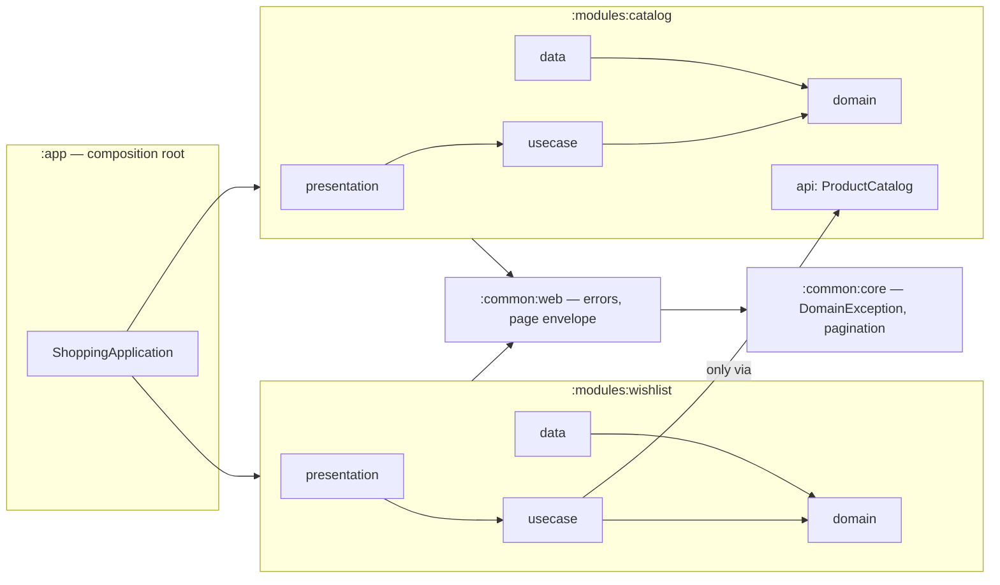

# Shopping Wishlist & Product Discovery API

A Kotlin + Spring Boot backend for a mobile shopping app. Clients can browse, search and filter a product catalog and manage a personal wishlist. It is built as a **modular monolith** with **Clean Architecture** layers, **dependency injection**, and **Coroutines/Flow** throughout.

- **Stack:** Kotlin 2.4, Spring Boot 4.1 (Spring MVC with `suspend` controllers), JDK 21, Gradle 9 with convention plugins.
- **Storage:** in memory. The catalog is seeded with 12 products at startup; wishlists live in memory, one per session.
- **Error format:** every error is an RFC 9457 `application/problem+json` body with a stable `code`.

---

## How to run

You need **JDK 21** (Gradle can download it for you through the foojay toolchain resolver).

```bash
./gradlew :app:bootRun          # starts on http://localhost:8080  (PORT=9000 to change)
./gradlew build                 # compiles, runs detekt + ktlint and all tests
./gradlew test                  # tests only
```

Once it is running:

- **Swagger UI:** http://localhost:8080/swagger-ui.html
- **OpenAPI document:** http://localhost:8080/v3/api-docs
- **Health check:** http://localhost:8080/actuator/health

### Try every endpoint with Bruno

`tools/bruno/` is a [Bruno](https://www.usebruno.com/) collection that covers every endpoint, each happy path and each error case. Every request asserts its own status and body, so it also works as a smoke test.

- **In the Bruno app:** open `tools/bruno`, select the **local** environment, then use **Run Collection**.
- **From the command line:** `cd tools/bruno && npx @usebruno/cli run --env local`

| Folder | What it shows |
|---|---|
| 01 Products | Default list, page 2, product by id, each filter on its own, all filters combined |
| 02 Search | Search, search plus a filter, paginated search |
| 03 Wishlist | New session empty → add → add → list → duplicate (409) → remove → remove again (404) → another session isolated |
| 04 Errors | 404 product, non-numeric id, inverted price range, non-numeric price, oversized page, blank search, missing session, unknown product |

The wishlist folder generates a fresh session id on every run, so the collection can be rerun without leftover 409s.

---

## Architecture



Each feature module has the same layers, and dependencies only point inwards:

| Layer | Contains | Example |
|---|---|---|
| `domain` | Entities, repository **interfaces**, domain errors. Plain Kotlin. | `Product`, `ProductDetails`, `ProductQuery`, `ProductRepository`, `SessionId` |
| `usecase` | One class per use case, `suspend operator fun invoke`. Plain Kotlin. | `ListProducts`, `SearchProducts`, `GetProductDetails`, `AddToWishlist` |
| `data` | Data sources: repository implementations. | `InMemoryProductRepository`, `InMemoryWishlistRepository` |
| `presentation` | Controllers and request/response DTOs. | `ProductsController`, `ProductResponse`, `ProductDetailsResponse`, `WishlistController` |
| module root | DI wiring: the module's composition root. | `CatalogModule`, `WishlistModule` |

### Key decisions

- **Plain Kotlin at the core.** `domain` and `usecase` contain no Spring code; Spring builds the beans in each module's `@Configuration`. As a result, use cases are unit-tested with plain constructors and fakes.
- **Module boundaries.** Everything except a module's `api` package is Kotlin `internal`. The wishlist checks that a product exists through `catalog.api.ProductCatalog` and can't reach the catalog's repository.
- **The rules are tested.** `ArchitectureTest` (Konsist) fails the build if `domain` or `usecase` imports Spring, if an inner layer imports an outer one, if a controller lives outside `presentation`, or if the wishlist imports anything from the catalog except `catalog.api`.
- **Coroutines and Flow.**
  - Controllers and use cases are `suspend` functions.
  - Repositories expose `Flow`: the catalog streams `ProductDetails` through `filter` and then `map(toProduct)`, and each wishlist is a `StateFlow`.
  - Concurrent wishlist edits are atomic, because `MutableStateFlow.update` is a compare-and-set loop.
- **Errors.** The domain raises `DomainException` with a `Kind` (`INVALID_INPUT`, `NOT_FOUND`, `CONFLICT`) and a stable `code`. Only `GlobalExceptionHandler` maps a kind to an HTTP status.

Detailed reasoning is in [`adr/`](adr/) and the design spec in [`docs/specs/`](docs/specs/2026-10-31-shopping-api-design.md).

### Wishlist session scoping (and why)

Each wishlist belongs to the session named by the **`X-Session-Id`** header. The client generates a UUID once and sends it on every wishlist call.

- **Why not one wishlist for everyone:** every user would see and edit each other's list, and no shopping app behaves that way.
- **Why a header and not a cookie:** native mobile HTTP clients don't keep cookies by default, and a client-owned id maps directly onto a user id once authentication exists.
- **Where it lives in code:** the full justification is the KDoc on [`InMemoryWishlistRepository`](modules/wishlist/src/main/kotlin/com/danzucker/shopping/wishlist/data/InMemoryWishlistRepository.kt) and in [ADR-0002](adr/0002-wishlist-scoped-per-session-header.md).
- **Limitation:** wishlists are lost on restart and sessions are never evicted. That's acceptable for this assessment; production would use Redis or a database with a TTL behind the same interface.

---

## Endpoints

All responses are JSON. Errors are `application/problem+json`.

### Two product models

The catalog has two models of a product, because the screens need two different amounts of it:

| Domain model | Response | Fields | Used by |
|---|---|---|---|
| `Product` (list model) | `ProductResponse` | `id`, `name`, `description`, `imageUrl`, `price` | `GET /products`, `GET /products/search` |
| `ProductDetails` (full record) | `ProductDetailsResponse` | all of the above **+ `brand`, `category`** | `GET /products/{id}` |

- **Why two:** a product grid doesn't show brand or category, so list items leave them out, which keeps each page light on mobile.
- **How they relate:** the data source stores `ProductDetails`, and lists are built from it with `ProductDetails.toProduct()`, so the list model can never contain anything the details don't.
- **Filtering still works:** filters run against the full details, so `brand` and `category` filter the list even though list items don't return them.

**List item** (`ProductResponse`):

```json
{
  "id": 2,
  "name": "WH-1000XM5 Headphones",
  "description": "Over-ear wireless headphones with industry-leading noise cancellation and 30-hour battery life.",
  "imageUrl": "https://picsum.photos/seed/wh-1000xm5/600/600",
  "price": 399.99
}
```

**Product details** (`ProductDetailsResponse`):

```json
{
  "id": 2,
  "name": "WH-1000XM5 Headphones",
  "description": "Over-ear wireless headphones with industry-leading noise cancellation and 30-hour battery life.",
  "imageUrl": "https://picsum.photos/seed/wh-1000xm5/600/600",
  "price": 399.99,
  "brand": "Sony",
  "category": "Electronics"
}
```

### Page envelope (list and search)

```json
{ "items": [ /* ProductResponse items */ ], "page": 1, "size": 20, "totalItems": 12, "totalPages": 1 }
```

### `GET /products`

Lists products ordered by id, **20 per page by default**. Items are `ProductResponse` (no brand or category).

| Query param | Meaning |
|---|---|
| `page` | 1-based page number, default `1` |
| `size` | Items per page, 1–100, default `20` |
| `brand` | Exact match, ignoring case (`nike` = `Nike`) |
| `category` | Exact match, ignoring case |
| `price_min`, `price_max` | Inclusive price range; either can be used alone |

Filters combine with AND. A blank filter (`?brand=`) is ignored. A page past the end returns `200` with an empty `items` array and the real totals.

```bash
curl "http://localhost:8080/products?category=Electronics&price_max=400&size=2"
```
```json
{
  "items": [
    { "id": 1, "name": "AirPods Pro (2nd generation)", "description": "Wireless earbuds with ...", "imageUrl": "https://picsum.photos/seed/airpods-pro/600/600", "price": 249.00 },
    { "id": 2, "name": "WH-1000XM5 Headphones", "description": "Over-ear wireless headphones ...", "imageUrl": "https://picsum.photos/seed/wh-1000xm5/600/600", "price": 399.99 }
  ],
  "page": 1, "size": 2, "totalItems": 2, "totalPages": 1
}
```

**Errors:** `400` `INVALID_PAGE`, `INVALID_PAGE_SIZE`, `INVALID_PRICE`, `INVALID_PRICE_RANGE` or `INVALID_PARAMETER` (for example a non-numeric price).

### `GET /products/{id}`

Returns one product's full details (`ProductDetailsResponse`), including `brand` and `category`.

```bash
curl http://localhost:8080/products/2      # 200, ProductDetailsResponse above
curl http://localhost:8080/products/999    # 404
```
```json
{
  "status": 404, "title": "Not Found", "instance": "/products/999",
  "code": "PRODUCT_NOT_FOUND",
  "detail": "No product with id 999 exists. List available products with GET /products."
}
```

**Errors:** `404` `PRODUCT_NOT_FOUND`; `400` `INVALID_PARAMETER` if `id` isn't a whole number.

### `GET /products/search?query=term`

Finds products whose **name or description** contains `query`, as a case-insensitive partial match. It accepts the same filters and pagination as `GET /products`, and returns `ProductResponse` items.

```bash
curl "http://localhost:8080/products/search?query=wireless"              # AirPods + Sony headphones
curl "http://localhost:8080/products/search?query=running&brand=adidas"  # Ultraboost only
```

**Errors:** `400` `MISSING_SEARCH_QUERY` if `query` is missing or blank, plus the filter errors listed above.

### Wishlist

Every wishlist call needs the header `X-Session-Id: <1–64 chars of letters, digits, - or _>`, for example a UUID.

#### `GET /wishlist`

Returns the product ids in this session's wishlist, oldest first. A new session gets an empty list.

```bash
curl http://localhost:8080/wishlist -H "X-Session-Id: 3f2b8c1e-9a4d-4e6f-8b2a-1c3d5e7f9a0b"
```
```json
{ "productIds": [3, 5] }
```

#### `POST /wishlist/{productId}`

Adds a product and returns **201** with the updated wishlist.

```bash
curl -X POST http://localhost:8080/wishlist/2 -H "X-Session-Id: demo"
```
```json
{ "productIds": [2] }
```

Adding the same product again returns **409**:

```json
{
  "status": 409, "title": "Conflict", "instance": "/wishlist/2",
  "code": "ALREADY_IN_WISHLIST",
  "detail": "Product 2 is already in your wishlist. Fetch it with GET /wishlist."
}
```

**Errors:** `404` `PRODUCT_NOT_FOUND` (not in the catalog); `409` `ALREADY_IN_WISHLIST`; `400` `MISSING_SESSION_ID`, `INVALID_SESSION_ID` or `INVALID_PARAMETER`.

#### `DELETE /wishlist/{productId}`

Removes a product and returns **204** with no body.

```bash
curl -X DELETE http://localhost:8080/wishlist/2 -H "X-Session-Id: demo"
```

**Errors:** `404` `NOT_IN_WISHLIST`; `400` `MISSING_SESSION_ID` or `INVALID_SESSION_ID`.

### Error format

Every error has the same shape. When a request parameter is at fault, `errors` names it:

```json
{
  "status": 400, "title": "Bad Request", "instance": "/products",
  "code": "INVALID_PRICE_RANGE",
  "detail": "price_min (50) must not be greater than price_max (10).",
  "errors": [{ "field": "price_min", "message": "price_min (50) must not be greater than price_max (10)." }]
}
```

| Status | When |
|---|---|
| 400 | Malformed or out-of-range input, or a missing or invalid `X-Session-Id` |
| 404 | Unknown product, product not in the wishlist, unknown route |
| 409 | Product already in the wishlist |
| 500 | Unexpected failure (generic message; details are only logged) |

---

## Testing

`./gradlew test` runs 62 tests across all modules.

| Kind | Where | What |
|---|---|---|
| **Use-case unit tests** | `modules/*/src/test/.../usecase` | `ListProducts`, `SearchProducts`, `GetProductDetails`, `AddToWishlist`, `RemoveFromWishlist`: filtering, case rules, inclusive price range, pagination, 404/409 rules, session isolation |
| Domain and data tests | `ProductDetailsTest`, `SessionIdTest`, `PaginationTest`, `InMemoryWishlistRepositoryTest` | List-model mapping, header validation, paging math, **concurrency**: 500 parallel adds lose nothing, and 200 parallel adds of one product succeed exactly once |
| HTTP tests | `app/src/test/.../*ApiTest` | Each endpoint through the full Spring context (`MockMvcTester`, which also covers async `suspend` handlers), including the exact field set of each product model and the error bodies |
| Architecture tests | `app/src/test/.../ArchitectureTest` | The Clean Architecture and module-boundary rules above |

**Testing approach:**
- **Fakes, not mocks.** Use cases run against real in-memory repositories and a `FakeProductCatalog`, so tests check what a user gets back rather than which calls were made.
- **Assertions:** kotest's `shouldBe`.
- **Coroutines:** use-case tests run in `runTest`.
- **Naming:** each test name is a sentence describing the behaviour.

---

## Project layout

```
app/                    Spring Boot entry point, application.yml, HTTP + architecture tests
common/core/            DomainException, PageRequest/Page/paginate (plain Kotlin)
common/web/             GlobalExceptionHandler (problem+json), PageResponse
modules/catalog/        api · domain · usecase · data (seed + in-memory repo) · presentation
modules/wishlist/       domain · usecase · data (per-session store) · presentation
build-logic/            Gradle convention plugins (Kotlin/JDK 21, detekt, ktlint, Spring BOM)
tools/bruno/            Bruno collection for every endpoint
adr/                    Architecture decision records
docs/specs/             The design spec this was built from
```
